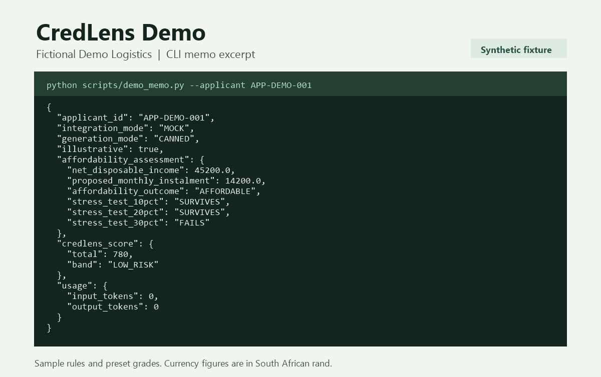
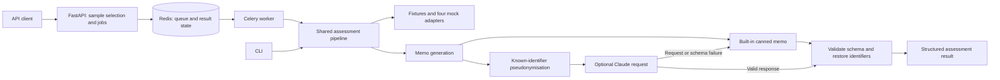

# CredLens Demo

A synthetic-data demonstration of an AI-assisted SMB credit assessment workflow for South African lenders.

## Demo



Excerpt from a local CLI run with `APP-DEMO-001`. The image uses the repository’s fictional inputs and built-in canned memo. It uses original artwork and is covered by the repository’s [MIT license](LICENSE).

## What it does

The API accepts a built-in fictional applicant, collects mocked company, bureau, bank-transaction, and screening responses, and returns a structured credit memo. The default memo shows illustrative affordability arithmetic, cash-flow stress tests, and a weighted score using preset component grades. Optional live generation sends pseudonymised fixture data to Claude and validates the returned memo against a schema before restoring known identifiers.

This engineering demo uses **synthetic data, mocked integrations, and illustrative scoring**. The output carries no lending decision, offer, or compliance certification.

## Workflow and architecture



The CLI calls the assessment pipeline directly and prints the result as JSON. For API jobs, the worker saves the result to Redis and the API retrieves it by job ID.

## Run the demo

Docker Compose runs the full API workflow. Python 3.12 is the recommended version for the standalone CLI and tests and is used in the container.

From the project root in PowerShell:

```powershell
$env:ANTHROPIC_API_KEY = ''
$env:CLAUDE_MODEL = ''
docker compose --env-file .env.example up --build -d
docker compose ps
```

Open the [local interactive API](http://localhost:8000/docs).

1. Send `GET /v1/applications/samples` to find a fixture `applicant_id`.
2. Send `POST /v1/applications` with `{"applicant_id":"APP-DEMO-001"}` and copy the returned `application_id`.
3. Poll `GET /v1/applications/{application_id}` until its status is `SUCCESS`.
4. Send `GET /v1/applications/{application_id}/memo` to retrieve the result.

The API binds to loopback. Jobs expire after 24 hours. `docker compose down` stops the demo and discards the stack’s temporary job state.

For the standalone CLI and regression suite, use these commands from the project root. The CLI needs only Python with the backend dependencies installed.

```powershell
cd backend
python -m venv .venv
.venv\Scripts\python -m pip install -r requirements.txt
$env:ANTHROPIC_API_KEY = ''
$env:CLAUDE_MODEL = ''
.venv\Scripts\python scripts/demo_memo.py --applicant APP-DEMO-001
.venv\Scripts\python -m pytest tests -q
```

## Configuration

The backend reads process environment variables. See the [backend example](backend/.env.example) for local settings and the [root example](.env.example) for Compose. Built-in memo generation works without an account.

| Variable | Purpose |
| --- | --- |
| `CORS_ORIGINS` | Optional JSON list of allowed browser origins. Defaults to the loopback addresses on port 8000. |
| `REDIS_URL` | Broker, result backend, and job store. Compose supplies it for the API and worker. |
| `ANTHROPIC_API_KEY` | Optional API key for live generation using synthetic fixtures. This and `CLAUDE_MODEL` must both be populated to call the provider. |
| `CLAUDE_MODEL` | Optional model identifier for the live adapter. |

## Failure handling

The API rejects unknown fixture IDs and extra submission fields with HTTP 422. If Redis or queue publishing is unavailable, affected job operations return HTTP 503. Unknown or expired jobs return 404. Memo requests for pending or failed jobs return 409.

If a live request fails or the response fails schema validation, the adapter uses the built-in memo. `generation_mode` identifies the source and usage records provider-reported tokens when available. `/health` reports the API process status.

## Key decisions and trade-offs

- **App-owned orchestration.** The architecture specification compared a single structured model request with an agent loop that selects and calls tools. The worker collects fixture data in Python before making the optional memo request. That gives the application control over inputs and provides a single response schema to validate. The canned memo keeps the same contract available offline.
- **Queued API and direct CLI.** FastAPI returns a job ID while Celery runs the assessment. Redis holds queue and job state with a 24-hour job expiry. The CLI illustrates the simpler synchronous alternative with the same assessment code. The broader concept included PostgreSQL persistence, an analyst portal, and cloud deployment. The public edition keeps the services used by the local workflow.
- **Fixture-only requests.** Callers submit the ID of a fictional applicant. The four adapters return local mock responses. The optional model adapter substitutes known structured identifiers using request-local maps and restores them after validation.
- **Transparent example arithmetic.** Canned scores apply fixed weights and bands to preset component grades. Affordability and stress labels apply sample rules to fixture income, expenses, and debt. Sample terms mirror the requested amount and tenor and use fixed example rates and covenants.

## How this was built

I directed the project and set the scope of this public edition around a credit-memo workflow using fictional applicants. The requirements and architecture documents framed the workflow from data collection through a structured memo, with the application controlling what the model sees. For publication, I directed the review of fixture safety, scoring claims, and which services belonged in the runnable demo. I specified provider-free demo verification and used Codex to update the publication copy and run automated checks for the CLI, API job lifecycle, score bands, and memo validation.

I used Claude Code during the original development and Codex for this publication pass.

## Scope and license

The demo is local and unauthenticated. Its two interfaces are the CLI and FastAPI’s interactive API docs. The implemented integrations are mocks. The scoring rules and amounts illustrate the memo structure and have no validation for use with real applications.

See [LICENSE](LICENSE) for the MIT license.
